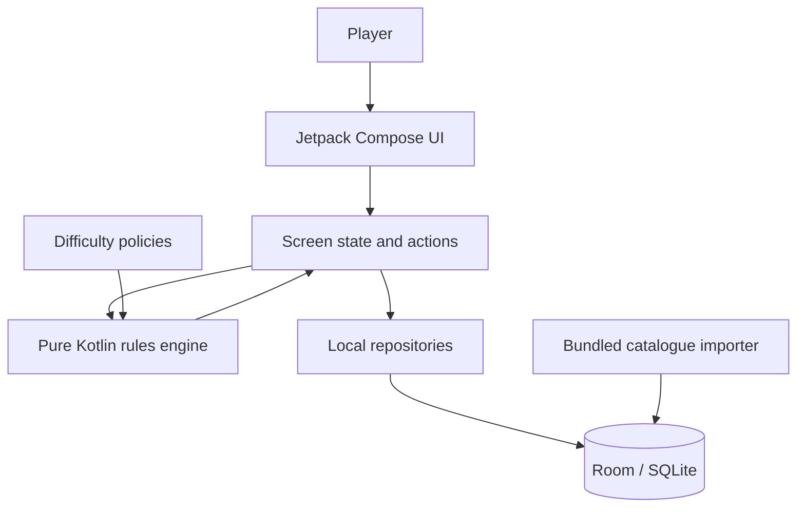

# Architecture

## Product boundary

The Android application is an **offline, single-device game**. It has no account, matchmaking, cloud-save, online multiplayer, ads or analytics dependency. The Ktor/PostgreSQL backend remains a separate scaffold and is not called by the Android app.

## Android modules and responsibilities

### Presentation — `app/src/main/java/.../ui`

- Compose screens render the home/navigation flow, catalogue, deck builder and battlefield.
- UI state is derived from local repositories and immutable engine state.
- UI events become typed `GameAction` values. The UI does not implement game rules.
- Local pass-and-play uses explicit handoff/private-hand states; it does not expose one player's hand while the other player is viewing the device.

### Domain — `app/src/main/java/.../engine`

- `DuelMastersEngine` is a pure Kotlin state machine.
- `GameState` contains players, zones, active turn, winner, pending player decisions and queued resolution steps.
- `GameAction` is the only mutation interface. The engine validates every action and returns Success or Rejected.
- `DuelMastersAi` proposes actions and responds to pending choices. It cannot bypass engine validation.
- `DeckValidator` is the shared deck legality boundary: minimum 40, no maximum, four copies per card name.
- `CardTextParser` maps a deliberately small set of known rules-text patterns into supported mechanics and classifies unsupported definitions as catalogue-only.

### Data — `app/src/main/java/.../data`

- Room stores card definitions, printings, catalogue metadata, owned-card records and saved decks.
- The bundled base64 SQLite source is decoded to app-private storage and opened read-only by the importer.
- Import runs transactionally and is versioned. Updating the catalogue upserts card definitions and printings without discarding saved decks.
- Search and deck eligibility are local database queries. No remote API is needed.

## First-launch data flow

1. `MainActivity` opens the local database provider.
2. The importer checks the stored catalogue version.
3. If import is required, it decodes the bundled source DB to app-private storage.
4. Card rows and printing rows are normalized and grouped; each definition receives `SUPPORTED` or `METADATA_ONLY`.
5. Room writes card rows, printings and import metadata in a transaction.
6. The app enters the home flow only after import succeeds. On failure, the user sees a retry path instead of a partially populated catalogue.

## Match flow and decision model

1. Match setup validates both decks and creates shuffled player zones.
2. The engine handles opening hands/shields, turn progression, mana and draw.
3. UI/AI submits an action to the engine.
4. The engine either applies the action, rejects it with a reason, or stores a `PendingChoice`.
5. When a decision is pending, only the matching response action is accepted.
6. Queued effects and remaining shield-break steps resume after the choice is resolved.
7. The UI renders the new immutable state.

See [gameplay flow](gameplay-flow.md).

## Security and privacy boundaries

- Android manifest contains no `INTERNET` permission.
- Android app backup is disabled.
- Card data and saved decks stay in app-private local storage.
- Release signing credentials are injected through environment variables / GitHub Actions secrets and must never be committed.
- The backend directory is not part of the Android runtime trust boundary.

## Build configuration

- Kotlin / Compose / Material 3
- Room / SQLite
- JDK 17, Gradle 8.11.1, Android Gradle Plugin 8.9.1
- compileSdk / targetSdk 36; minSdk 26
- R8 and resource shrinking enabled for release
