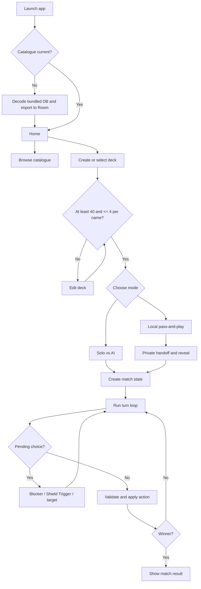
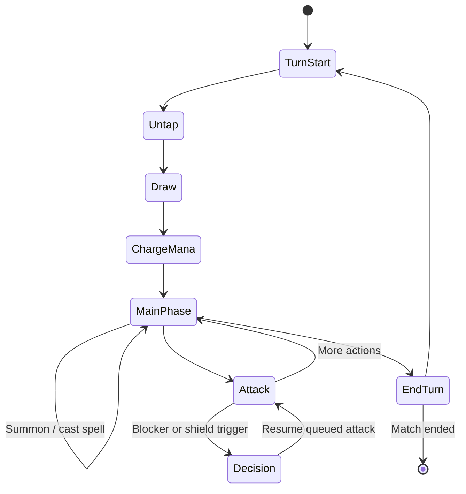

# Gameplay flow

## High-level player journey

## Match setup

The rules engine validates each deck before match construction. It shuffles card instances, draws opening hands, and places the opening shields. Game state is immutable: actions produce a new state rather than mutating a screen-owned object.

## Turn lifecycle

The UI may allow a player to skip optional actions. The engine remains responsible for legality, mana payment, turn order, summoning sickness, attacks and win conditions.

## Pending choices and queued resolution

Some rules require a player to choose before the game can continue. The engine stores a typed `PendingChoice` and rejects unrelated actions until the matching response is received.

- A Blocker choice records the attacker, destination and legal blocker IDs.
- A Shield Trigger choice records the defending player and revealed shield card.
- An effect-target choice records the effect, target player and legal target IDs.
- A resolution queue stores remaining shield breaks and spell effects so a decision does not lose the rest of an attack's resolution.

The AI responds through the same action types as a human player. The engine validates AI responses exactly as it validates human actions.

## Local pass-and-play deck selection

Player 1 and Player 2 select their saved decks independently. If only one saved deck exists, it is used for both sides; with multiple saved decks, Player 2 can choose a different list entry. Before match creation, both decks must pass the same minimum-40/no-maximum/four-copies validator and every stored card reference must still resolve to a playable card. Missing or corrupt references disable Start instead of silently shortening a deck.

## Local pass-and-play privacy

A local match has one shared device, not two accounts. The UI must explicitly hand off the device and hide the previous player's hand before revealing the next player's private hand. Public zones remain visible. A defender-choice handoff returns control to the attacker only after the decision is resolved; local mode then requires the appropriate private-hand transition again.

## Match end

The engine sets a winner when a player decks out or when an eligible attacker makes a direct attack against a player with no shields. Once a winner exists, further actions are rejected.
